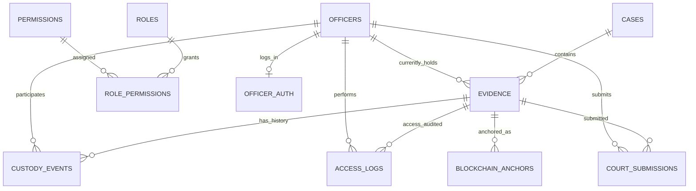

# EviLedger database design

## Entity relationships

## Tables and controls

| Area | Tables | Integrity controls |
|---|---|---|
| Investigation | `cases`, `officers` | Unique case number and badge; required identifiers |
| Evidence | `evidence`, `evidence_types` | Case and custodian foreign keys; original hash immutable trigger |
| Custody | `custody_events`, `event_types` | Append-only event payload; previous-hash chain; immediate transfer transaction |
| Access and court | `access_logs`, `court_submissions`, `courts` | Foreign keys to evidence and officers |
| Authorization | `roles`, `permissions`, `role_permissions`, `officer_auth` | Unique role/permission names; salted PBKDF2 password hashes |
| Ledger | `blockchain_anchors`, `transaction_log` | Pending/anchored states; transfer and anchor records commit together |
| Recovery | `backup_history` | SQLite backup API, integrity and FK checks before restore |

Indexes cover evidence case/hash searches, evidence custody history, and officer access activity. Views provide evidence details, custody history, officer activity, court submissions, and evidence anchor counts.

## Normalization status

The supplied project database is retained for compatibility. Role and permission relationships are normalized through lookup and join tables. The original workflow schema still stores role, department, evidence type, event type, and court name labels as text on operational rows. Catalog tables for several of these domains are present, but existing values are not yet migrated to foreign-key IDs. Therefore the retained operational tables do not fully meet 3NF for those descriptive values; `schema.sql` documents the intended catalog-based shape. Existing database files are preserved and are not silently rebuilt.

## Transaction and local ledger behavior

A transfer runs under `BEGIN IMMEDIATE`, reads current custody, creates the next canonical event hash using the previous hash, inserts a pending local anchor, changes the custodian, records the transaction outcome, and commits as one unit. A failure rolls back the operation; a failure outcome is written separately. Pending local anchors can be reconciled from their source event/evidence hash. SQLite is a local database and the ledger is a simulation, not a decentralized blockchain.
